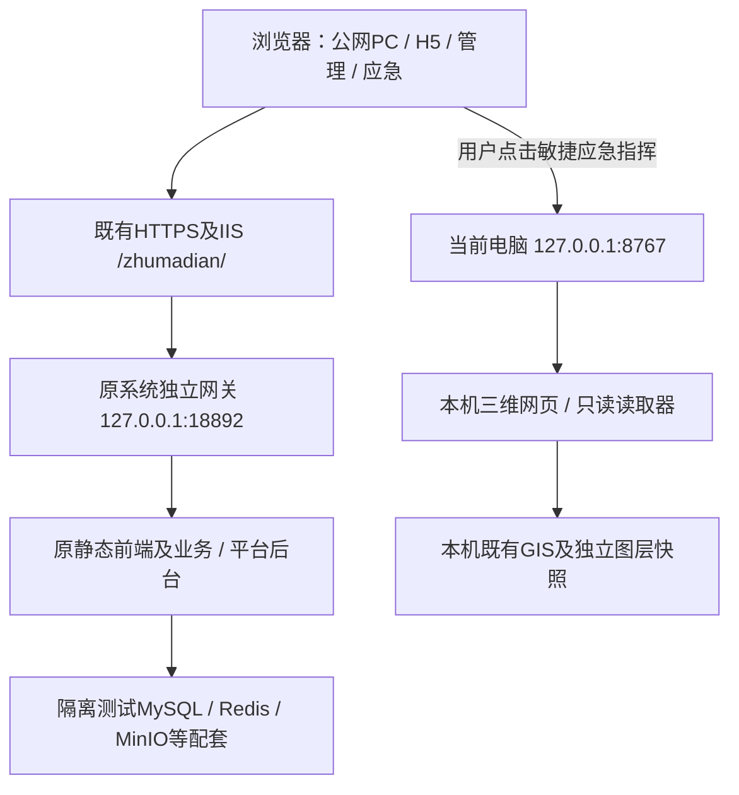

# 驻马店重大风险防控 R4 测试版设计说明

版本快照：20261025-r4-dual-machine。业务源码基线为Git main的8185111e；这是测试版的发布与双机接入基线，完整天津南港复刻仍待逐项验收。2026-10-25更新。

## 目标与当前范围

第一阶段目标仍是以Reference目录中的天津原项目为依据，前端页面、内部操作、后台处理和原测试数据严格对照，项目名称改为“驻马店重大风险防控”。已采用原工程构建的PC、H5、管理平台及应急前端，接入配套原后台与由既有逻辑导出恢复的独立测试种子；不能因页面可访问就认定全部模块、角色、流程和数据一致。手机本轮交付范围为网页，Android APK不在当前范围。

当前事实：R4于2026-10-25 18:03完成服务器新后台ready、IIS切换与服务器本机TLS验证；外部检查PC/H5/管理/应急HTML和登录配置接口可读。252已在登录后的公网原组件首页实际点击“敏捷应急指挥”，进入本机三维，显示14家企业、16个标注及近景建筑纹理；250本机三维服务保持正常。当前不是云端渲染地景。

## 组件与数据流

250和252的127.0.0.1分别指向各自电脑。公网认证Cookie、token和用户名不拼入本机场景URL；跳转地址固定为http://127.0.0.1:8767/?topic=emergency&mode=command。14家企业点位沿用既有图层，位置为资料估算、厂界待核实；图层数量不能当作实时业务统计。

## 部署适配与边界

自有适配集中在构建/网关/部署层：原首页站点子路径适配，本机三维跳转，项目名称及自绘应急图标，IIS固定目标代理和受控离线修复。原Reference源码保持原样，按固定构建副本/配方使用。原页面和接口的业务语义应在对照中验证，不以本项目重新设计的流程替代。

IIS代理固定指向本机18892，支持原认证头、Cookie、常用业务HTTP方法及规定的范围下载和WebSocket分支。R4只修正既有HTTPS预检：接受经证书/主机名/SNI校验的200、301、302、303、307、308，检查时不跟随Location；认证错误、服务错误和无效证书仍拒绝。后续新页面/接口验证门槛不变，HTTP状态和异常保留到部署报告。

本机三维由独立启动器持有其服务和读取器，关闭持有窗口会结束自有进程。当前未配置开机自启、Windows服务或自动重启。原生实验性加载改动与正式运行包按清单区分；14项未验收本地修改保留，不并入当前已发布基线。

## 数据、版本与验收

原系统测试库和既有旧R2业务库独立，当前新服务未修改旧后台或旧库。数据种子由此前逻辑导出恢复并正常关闭后封装，不复制正在运行的原物理库。源码Git不包含数据库、原数据、GIS、Reference、SDK运行包或凭据；复建仍需要既有私有输入及其固定清单，Git源码本身不等于包含原运行资料的安装包。

当前发布身份、补丁SHA、包大小、引擎基线及文档SHA见[版本快照](current_test_release_snapshot_20261025.json)。没有数据库字段/索引/状态结构变化，本次文档同步不重新生成数据库模型或启动数据库。

运行可用性、源码测试、原数据一致性、实际业务行为分别验收。全模块对版、权限审批、真实附件、手机真机、长稳/服务器重启、全区20秒外围清晰度均仍有待完成项，见[验收矩阵](current_test_release_acceptance_20261025.md)。用户尚未完成第一阶段全面复核，fullCloneReady=false。
