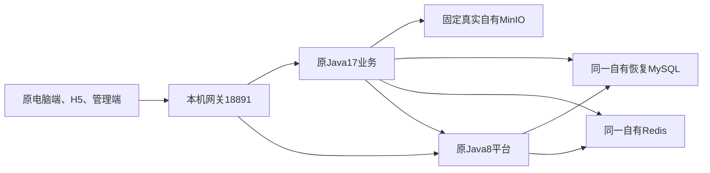

# 原后台对象存储接入、持久性与原网关回读验收（2026-10-24）

记录时间：2026-10-24T20:14:54.196596+08:00。本阶段已将固定真实MinIO接入完整原Spring候选，实际MinioConfig六字段绑定、原Spring文件服务上传/Base64回读及原HTTP控制器经网关取回69字节/SHA均通过。探针通过自有签名S3删除并HEAD404确认，不删除桶或其它对象。此处没有认证HTTP上传、用户页面提交或历史附件恢复通过的证据，完整复刻和公网同版仍未达成。

## 运行结构与范围

原业务类、原JAR和Java17边界Jar SHA3f5b36ef不改；只是增加经过核验的自有存储部署映射与自己的观察工具。新模式明确要求固定原配置及pin，固定provider收据及pin，先原平台main/初始化/存活通过，再准备业务配置。默认原三端口模式仍准确三端口；启用存储时准确四项是MySQL、Redis、已核验原平台、已核验自有MinIO，拒绝额外/重复/不匹配端口及非本机、凭据、路径、query/fragment的基地址。平台进程仍只有自己的MySQL/Redis范围，没有给它增加存储权限。

原桶名称来自固定哈希Y盘配置；地址、端口、SSL、accessKey、secretKey来自新自有实例。没有复制原存储凭据。Java overlay用已验证YAML节点解析器，仅复制桶身份；18项映射/拒绝检查通过，原配置和原输入前后哈希相同。六字段实际Spring绑定逐项与新配置比较，凭据只比较、不输出。

固定源MinIO commit9e49d5e7a648f00e26f2246f4dc28e6b07f8c84a、151191040B exe SHA c77e84bcf783e72a2d20f89767b0076369939dd1e693d11706205dabbfd89fda复用，不重复下载/构建SDK或复制原资源。源码/许可仍保留在既有retained-source。实际Popen PID监听归属确认只有同一端口127.0.0.1及::1回环；其它地址、通配符及其它端口不接受。

## 持久目录和独占运行

应用附件固定存于Application/UserData/TianjinOriginalObjectStore/data；同层identity.json记录自有数据身份，credentials.private.json保存自有随机密钥且有身份哈希校验，owner.lock阻止并行写实例。这是用户将来在候选中上传附件的数据目录，不能作为可重建缓存删除，也不能在候选结束时清空；运行临时文件、certs/profile与日志留在独立运行root/s。

已对真实provider进行两次启动、15项检查：新自有随机桶写50字节合成标记，签名正常停止后重启，数据owner、目录和密钥哈希不变，GET字节/SHA一致；第二并发拥有者在Popen前被锁拒绝，第一进程存活不受影响；最后仅删该合成标记/桶，两个实例签名停止HTTP200、自然退出0。该实验在当前候选启动前执行，当前候选已持有同一目录锁，不能为了重复测试再强启一个实例或绕过锁。独立镜像可以核验相同源码/收据，并在其它新自有数据目录设计验证；本轮不在运行中的数据目录复跑持久性试验。

新增精确.gitignore规则/UserData/TianjinOriginalObjectStore/，实际check-ignore命中；不移除既有已跟踪数据。候选结束仅正常停服务，保留持久目录及凭据。备份/恢复必须把关联业务库与对象数据作为一致性组合，未验证的在线目录拷贝不算恢复验收；本阶段尚未执行用户附件的整套备份恢复演练。业务数据库字段、索引、状态及归属均未修改，没有新增业务表。

## 源码与组件验证

27项原三端口回归、27项新四端口真实TCP/HTTP拒绝检查、18项原桶/自有凭据映射通过。范围夹具不含原应用或数据库classpath；Spring观察器在这一步只编译，不把编译当运行。共享HTTP/签名/回环检查提取到original_object_store_runtime.py，原4样本48项真实文件读写与签名自然停止、5项Python范围/pin检查复验通过。一次不合适的tools包导入在创建测试目录/启动provider之前失败，改用公开CLI通过，非应用或对象存储故障。

新实际业务进程的OriginalBusinessLaunch、OriginalObjectStoreObservation及其OwnPart class逐字节等于通过范围夹具时的编译结果；实际overlay class也一致。冻结控制器SHA a86651981cee458a6014193abfe8d24514c82b7dda206fbaba059a71c2ba8065与当前文件相同；其它自有接线源码也与本轮受控执行来源相同。原Java17边界能力不变，四端口来源均为实际自有服务；没有放开任意外网、子进程或系统设置。

## 原Spring及原HTTP链路的实际证据

own-j7启动后原两main均返回，原14业务参数、2内部URL、2 JDBC原时区、共享原Redis非认证往返及原可写计数继续通过。新ApplicationReady观察器通过实际Spring注入的MinioConfig/MinioClient/SysFileService执行原方法，六配置字段一致；上传本轮随机owner形成的69字节合成文本后，stat大小、原Base64回读字节一致。

随后使用原SysFileController的既有匿名下载路由，通过/zhumadian/api/serv/sys-file/...真实网关GET：HTTP200、69字节、SHA 160ab59dde4b9c784ec90c3a666b8ca2eaa328831d4c2eb566baab13863cb927。没有创建新诊断HTTP端点、没有提供假JWT或修改IgnoreAuth。先以自有签名S3 GET重新确认内容确实属于该owner的合成探针，再DELETE该单对象、HEAD404；没有删桶或其它对象。生成的对象标识仅在本地私有观察文件中，Git不包含标识或数据。该链路证明原Spring上传方法及原匿名HTTP下载，不证明带原账号的HTTP上传、数据库关联保存、用户界面上传/预览或全部业务权限通过。

| 验收项 | 当前结论 | 证据 |
| --- | --- | --- |
| 真实存储的原服务4样本字节回读 | 通过 | shared_original_file_roundtrip.json，48检查 |
| 跨正常重启数据/密钥保留、排斥并发拥有者 | 通过 | persistent_restart.json，15检查 |
| 实际Spring文件配置及原方法回读 | 通过 | joint_candidate_ready.json，6绑定 |
| 原网关匿名下载及单探针清理 | 通过 | HTTP200/69字节/SHA，S3 HEAD404 |
| 原账号HTTP上传与数据库关联保存 | 待验 | 未提交登录、验证码或JWT |
| PC/H5上传操作、图片/PDF预览、手机实机 | 待验 | 当前只到原登录界面及浏览器尺寸预览 |
| 历史62对象及1未知标记 | 未恢复 | 原环境取证仍待 |
| 当前own-j7完整租约正常停止 | 待观察 | 当前仍在运行，不能借组件/上轮退出作证明 |
| 天津完整复刻、公网同版上线 | 未达成 | fullCloneReady=false，未发布候选 |

## 运行、入口与关闭

旧own-j6在19:46:40.858572已真实终态，两个后台/MySQL/Redis/Nginx五组件自然退出0，两个ContextClosed与管理静态资源关闭通过；旧45088/预览98418不再poll或重启。新own-j7唯一句柄66987，新预览64399；当前尚未终态，约2026-10-24T21:57:49.323638+08:00结束。入口为http://127.0.0.1:18891/zhumadian/home 、/zhumadian/h5/ 、/zhumadian/admin/ ，手机尺寸预览http://127.0.0.1:18892/ 。均实查HTTP200。

新浏览器电脑3071/预览3074已实际显示原登录页；手机frame宽390高844，scroll宽高同值，无横向溢出。截图已查看，手机截图包括尺寸预览外壳，不声称手机真机或登录后页面；不调整全浏览器viewport、不触碰旧交接表单。自动化未输入/提交账号、密码、验证码；ready中的未登录标志只是就绪时快照，用户后续操作需另核实。

候选启动命令在原semantics选项外增加--object-store-provider-receipt及--object-store-provider-receipt-sha256，当前--minutes120。若上一收据含存储，必须确认它已正常退出0且未强制结束，才复用持久目录。正常结束先网关/原后台，再存储签名停止、Redis/MySQL，保留用户数据；失败记录分别报告强制标记，不算正常验收。不要因观测超时重复启动。若需要提前结束，只向本轮root/stop写停止标记，不重启8767或252原环境。

## 预览空闲连接故障的复现与修正

阶段记录校验时，原电脑/H5/管理入口均毫秒返回，但18892超时。旧预览是单线程HTTPServer，浏览器建立空闲TCP而未发请求行时，accept后的读取会阻塞其它客户端；server.timeout只限制接收等待，不能限制该连接读取。以旧固定源码在随机端口主动保持空闲socket，已实际复现health被阻塞，测试自己关闭空闲socket后旧实验进程自然0结束。

新预览改ThreadingHTTPServer、连接读取超时2秒、显式Connection: close，并处理浏览器断开。真实进程试验在空闲连接仍在时4并发GET分别200/200/404/200，空闲socket按时关闭，再持第二空闲socket发停止标记也自然退出0；HTML SHA c292adcd完全不变，没有改H5/原网关或表单。首次草稿保护因已有同名工作文件未覆盖而停，首轮所谓新试验实际SHA仍旧，结果不采用；核对源码哈希后r2才是真正通过结果。

原本机预览r2/14813在正常停止标记后仍被浏览器空闲连接卡住，故核验18892唯一PID34584、python.exe及本轮脚本/输出目录/own-j7命令标记后，仅结束该自有只读QA进程；该旧预览退出1，按强制关闭记录，不能称自然0。未结束后台/H5、浏览器或8767。新线程预览r3唯一64399已经恢复同一18892，按同一候选租约结束；旧页面已经加载的表单与尺寸控件没有重载。当前新预览未终态，不借试验的退出0证明其未来关闭结果。

## 交付范围与剩余工作

本轮15文件是.gitignore、共享持久runtime、原文件验证器重构、联合控制器、存储overlay/scope/lifecycle工具、5个Java自有启动/观察/夹具、手机预览并发修复/传输测试以及本handbook。只同步自有源码/测试/说明；原工程/类/JAR/前端资源包/数据库/附件/凭据/截图/生成结果/held不入Git。新增对象目录已经忽略。14held SHA未变，正式8767仍starts1/alive=true/failed=false、加载失败0/保护写入0；公网和252业务不操作。无新整库/GIS/原JAR或大依赖副本。

还需真实登录及角色菜单、原账户HTTP写操作、全模块/工作流、历史对象恢复、文件预览/手机真机、原有效配置与剩余外部服务、公开部署及迁移验收。3角色引用差异、9孤立初始化记录/4缺失定义仍保持原记录且未解决，不把可启动当严格同版通过。完整UE级引擎、EXE点线面图层、网页3D、目录迁移归档及天津完整复刻目标均继续active；20秒外围清晰与完整复刻均未通过。
